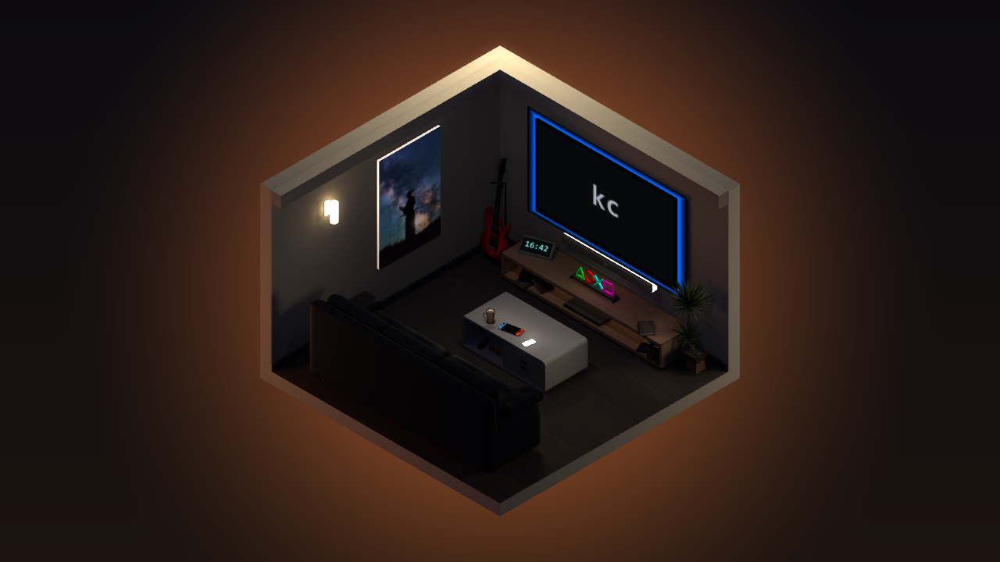

# RoomSaver

A cozy, low-poly isometric **"room in a box"** screensaver for Windows that reacts to
whatever music you're playing.



- **TV shows the current track's album art**, taken from Windows' own now-playing
  info (Spotify, browsers, media players, anything that shows up in the volume flyout).
- **Background glow and TV bias lights take on the album's dominant color.**
- **Bias lights pulse to the beat**, detected from your speakers' output.
- A working **digital clock**, a **framed picture** you choose, and a warm wall lamp.
- **Multi-monitor:** show the room on your main screen, on all screens, or on the
  screens you pick. The other screens go black.
- Everything runs locally: no accounts, no API keys, no network access.

Native C++20, Win32 + OpenGL 3.3, with HDR bloom. All dependencies are vendored, so
there's nothing to download besides Visual Studio.

---

## Requirements

- **Windows 10 or 11** (x64)
- A GPU with **OpenGL 3.3** (any NVIDIA / AMD / Intel GPU from the last decade)
- **Visual Studio 2022 or newer** with the **"Desktop development with C++"**
  workload. It already includes the compiler, CMake and the Windows SDK.

## Build

### Option A: Visual Studio (no command line)

1. Clone or download this repository.
2. In Visual Studio: **File → Open → Folder…** and pick the repository folder.
3. Choose a Release configuration from the configuration dropdown in the toolbar.
   If only `x64-Debug` is listed, pick **Manage Configurations… → + → x64-Release**.
   Then **Build → Build All**.

### Option B: command line

Open **"Developer PowerShell for VS"** (from the Start menu) in the repository folder:

```powershell
cmake -S . -B build -A x64
cmake --build build --config Release
```

Either way, you get a ready-to-use folder (`build\Release\` from the command line,
or `out\build\x64-Release\` from Option A):

```
RoomSaver.exe          # run it to see the room in a window
RoomSaver.scr          # the same program, as a screensaver
RoomSaver-Secure.bat   # screensaver that locks the PC when dismissed
shaders\  assets\      # needed next to the .exe / .scr
```

**Try it:** double-click `RoomSaver.exe`, play some music, and watch the TV.

## Install

1. **Copy the whole output folder** somewhere permanent, e.g.
   `C:\Users\<you>\RoomSaver\`. The screensaver loads `shaders\` and `assets\` from
   beside itself, so keep everything together and don't copy the lone `.scr`
   into `System32`.
2. Pick one or both:
   - **As your screensaver:** right-click `RoomSaver.scr` → **Install**. In the
     dialog that opens, choose the wait time and tick **"On resume, display logon
     screen"** if you want it to lock your PC.
   - **On a hotkey, locking on dismiss:** right-click `RoomSaver-Secure.bat` →
     **Create shortcut**, move the shortcut to your Desktop, then open its
     **Properties**, click **Shortcut key**, press a combo (e.g. `Ctrl`+`Alt`+`L`)
     and set **Run: Minimized**.

Move the mouse or press a key to exit. More detail, plus a registry-based setup,
is in [docs/INSTALL.md](docs/INSTALL.md).

## Settings

Run `RoomSaver.exe /c`, or click **Settings…** in the Windows screen saver dialog:

| Setting | What it does |
|---|---|
| Framed picture | Any PNG/JPG/BMP. It's cover-fit to the frame (no stretching). |
| TV text when nothing is playing | Wordmark on the idle TV (default `kc`). Leave empty for a blank screen. |
| Show the room on | **Main screen only** (default), **All screens**, or **Chosen screens** ticked in the list. Screens without the room go black. **Identify** flashes each screen's number. |
| Beat sensitivity | How strongly the lights pulse to the music (0.2–3.0) |
| Brightness | Overall scene brightness (0.5–2.0) |

Settings are stored per user in `HKCU\Software\RoomSaver`.

## Make it yours

- **Picture:** choose one in Settings, or replace `assets/picture.jpg`.
- **Your own room:** model it in Blender and export `assets/room.glb`. A few object
  names tell RoomSaver where the TV screen, picture, clock and lights are. See
  [docs/ASSET_CONTRACT.md](docs/ASSET_CONTRACT.md). If `room.glb` is missing,
  a simple placeholder room is used.

## How it works

| Piece | Implementation |
|---|---|
| Window / GL context | Native Win32 + WGL, OpenGL 3.3 core (`src/core/platform.cpp`) |
| Rendering | glTF via cgltf, forward lambert + emissive, fixed ortho isometric camera, 4× MSAA HDR + bloom (`src/app.cpp`, `src/core/postfx.cpp`, `shaders/`) |
| Album art | Windows System Media Transport Controls via C++/WinRT, on a background thread (`src/core/nowplaying.cpp`) |
| Beat detection | WASAPI shared-mode loopback → KISS FFT → bass-onset envelope (`src/core/audiobeat.cpp`) |
| Multi-monitor | One window over all screens; the room is rendered into each chosen screen's area, the rest stays black (`src/core/monitors.cpp`) |
| Settings dialog | Win32 dialog + registry (`src/core/config.cpp`, `src/core/settings.cpp`) |

The command-line flags (`/s`, `/p`, `/c`, `/lock`, `--selftest`) are listed in
[docs/INSTALL.md](docs/INSTALL.md#command-line-reference).

## Privacy & system impact

- No network access. Album art and track info come from Windows itself.
- Audio capture is shared-mode loopback, so it never takes over your audio device.
- No admin rights needed. The only thing written is `HKCU\Software\RoomSaver`.
- A diagnostic log is written to `%TEMP%\RoomSaver.log`. It includes the title of
  the track playing at startup.

## Limitations

- Windows only.
- Each extra screen that shows the room is another full render, so many large
  screens on a weak GPU may lower the frame rate.
- Album art only appears for players that publish it to Windows' media controls.

## License

[MIT](LICENSE) © 2026 kc ([@rohan37kumar](https://github.com/rohan37kumar)).
Bundled third-party libraries keep their own licenses. See
[THIRD_PARTY_NOTICES.md](THIRD_PARTY_NOTICES.md).
